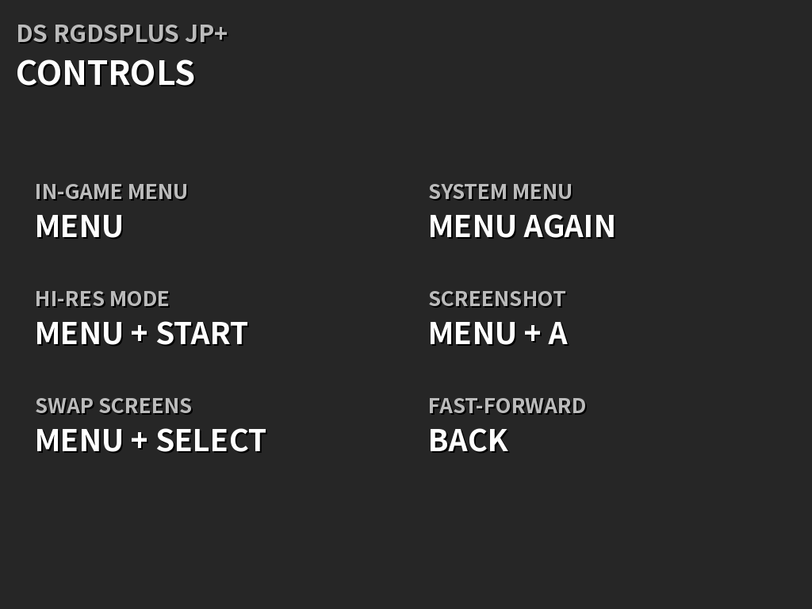

[English](README.md) | 日本語

# monoDS RG DS PLUS

RG DS Plus向けの[DEDICATED OS](https://github.com/dedicated-os/dedicated-rgds-plus)を土台にした日本語対応パッケージです。オリジナル作者の帰属とライセンスを尊重しています。

本バージョンでは、TF1のSDカード1枚だけでも、TF1とTF2のSDカード2枚でも起動できるようになりました。日本語ROM対応とHi-Res 3D対応も追加しています。

|  |  |
| :---: | :---: |
| **Bootlogo** | **Original** |
|  |  |
| **x2** | **Hi-RES** |

### x2

x2（Scale2x）は、元のピクセル感を保ちながら輪郭をなめらかにし、画質を向上させるための表示モードです。見え方はゲームや好みによって異なるため、Originalと見比べて気に入ったほうを選んでください。例：**ポケモンレンジャー**。

### Hi-RES

Hi-RESは3D描画の解像度を上げます。**ポケモンレンジャー**や**マリオカートDS**のような3D中心のタイトルでは画質が向上します。一方、**New スーパーマリオブラザーズ**のような2D中心のタイトルでは、元の表示より画質が落ちて見えることがあります。タイトルごとに切り替えてお好みの表示を選んでください。

## DEDICATED OSとの主な差分

- 日本語ROMのゲーム名表示に対応
- Hi-Res 3Dに対応
- TF1のSDカード1枚だけでの起動に対応

## 導入方法

### TF1のみで使用する場合

1. [Releases](../../releases)から最新のmonoDS RG DS PLUSパッケージをダウンロードして解凍します。
2. パッケージの中身をTF1/INT用SDカードのルートにコピーします。
3. `/games/`にゲームを配置し、SDカードをTF1/INTスロットに挿入して起動します。

### TF1とTF2を使用する場合

1. [オリジナルの `main-rgds-plus` Releases](https://github.com/dedicated-os/main-rgds-plus/releases)からシステムイメージをダウンロードし、[オリジナルプロジェクトの手順](https://github.com/dedicated-os/dedicated-rgds-plus)に従ってTF1/INT用SDカードに書き込みます。
2. オリジナルプロジェクトの説明に従ってTF2/EXT用SDカードを準備します。
3. 本リポジトリの[Releases](../../releases)から最新のmonoDS RG DS PLUSパッケージをダウンロードして解凍し、中身をTF2/EXTのルートにコピーします。
4. TF2/EXTの`/games/`にゲームを配置し、2枚のカードを本体に挿入して起動します。

### アップデート

1. [Releases](../../releases)から最新のmonoDS RG DS PLUSパッケージをダウンロードして解凍します。
2. `system.zip`、`bootlogo-0.bmp`、`bootlogo-1.bmp`を使用中のSDカードのルートに上書きコピーします（TF1のみの場合はTF1/INT、2枚構成の場合はTF2/EXT）。
3. 本体を起動すると、起動時にシステムが更新されます。

## 操作方法

本体の **MENUボタン** を押すとゲーム内メニューが開きます。もう一度押すとシステムメニューが開きます。

| 操作 | ショートカット |
| :--- | :--- |
| Hi-Resモード切り替え | `MENU + START` |
| 上下画面の入れ替え | `MENU + SELECT` |
| 画面グリッドの切り替え | `MENU + R2` |
| スクリーンショット保存 | `MENU + A` |
| 明るさ調整 | `MENU + 音量 + / 音量 -` |
| 早送り | `BACK` |

`MENU + A`で上下画面を1枚に結合した1024×1536のBMP画像を`userdata/screenshots/`に保存します。ファイル名はゲームタイトルと連番（例：`Game Title-0001.bmp`）です。

Hi-Resモードを切り替えると、ゲームを自動で保存・再起動し、そのまま再開します。

## クレジット

土台となるRG DS Plus向けDEDICATED OSは[shauninman](https://github.com/dedicated-os/dedicated-rgds-plus)氏が制作・管理しています。ドキュメントとライセンスについては[オリジナルプロジェクト](https://github.com/dedicated-os/dedicated-rgds-plus)をご確認ください。
