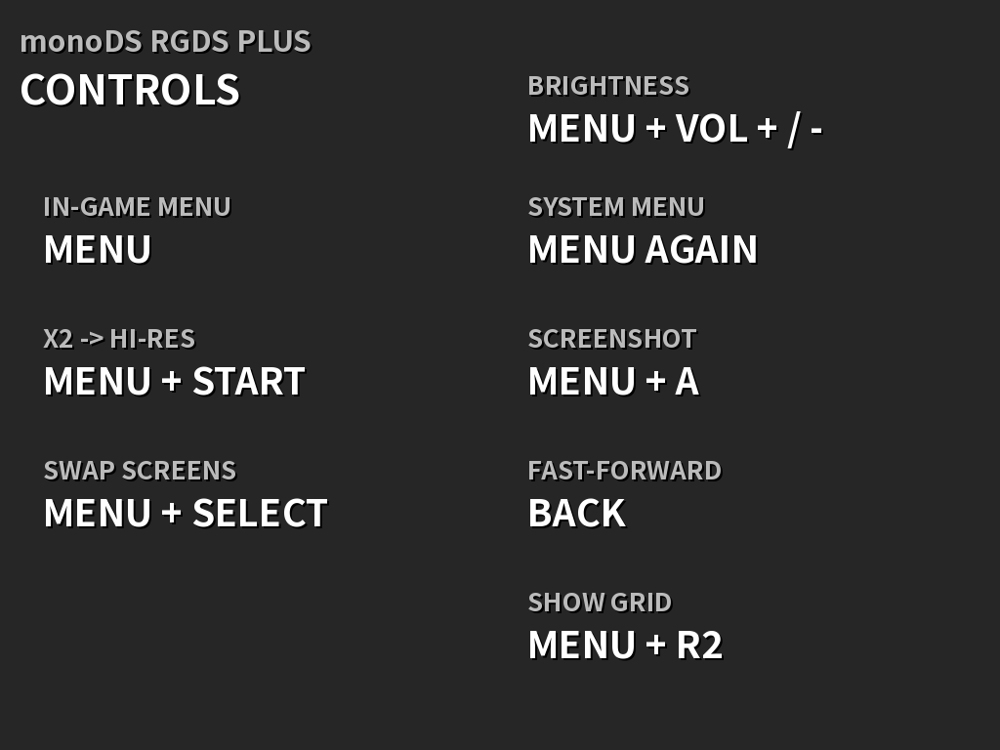
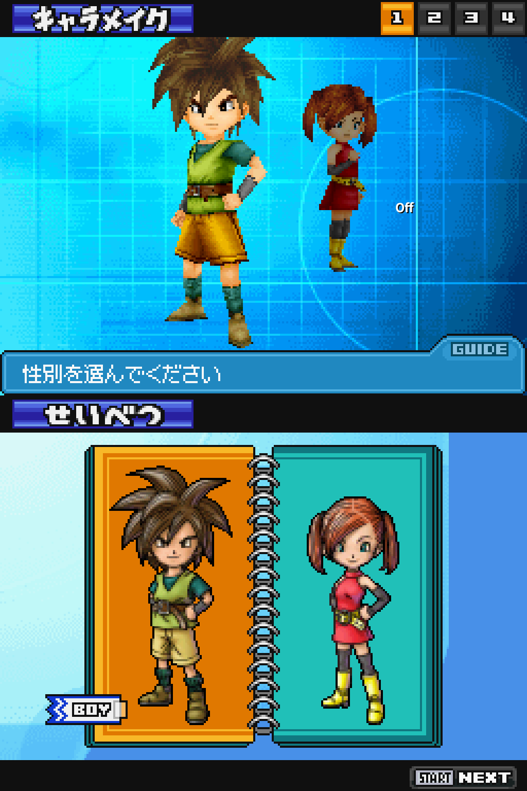
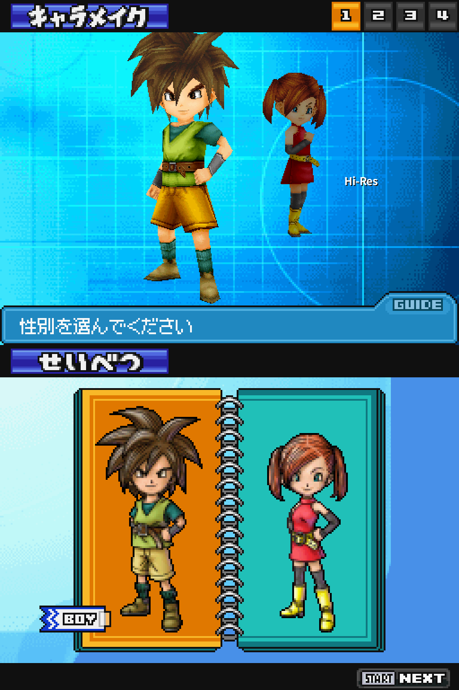

[English](README.md) | 日本語

# monoDS RG DS PLUS

RG DS Plus向けの[DEDICATED OS](https://github.com/dedicated-os/dedicated-rgds-plus)を土台にした日本語対応パッケージです。オリジナル作者の帰属とライセンスを尊重しています。

本バージョンでは、TF1のSDカード1枚だけでも、TF1とTF2のSDカード2枚でも起動できるようになりました。日本語ROM対応とHi-Res 3D対応も追加しています。

|  |  |
| :---: | :---: |
| **Bootlogo** | **Original** |
|  |  |
| **x2** | **Hi-RES** |

### x2

x2（Scale2x）は、元のピクセル感を保ちながら輪郭をなめらかにし、画質を向上させるための表示モードです。見え方はゲームや好みによって異なるため、Originalと見比べて気に入ったほうを選んでください。比較例：2Dアクションの**星のカービィ 参上！ドロッチェ団**。

### Hi-RES

Hi-RESは3D描画の解像度を上げます。3D中心のタイトルでは画質が向上しますが、**星のカービィ 参上！ドロッチェ団**のような2D中心のタイトルでは画質が落ちて見えることがあります。タイトルごとに切り替えてお好みの表示を選んでください。

## DEDICATED OSとの主な差分

- 日本語ROMのゲーム名表示に対応
- Hi-Res 3Dに対応
- TF1のSDカード1枚だけでの起動に対応

## 導入方法

### TF1のみで使用する場合

1. [Releases](../../releases)から`monods-rgdsplus.img.zip`をダウンロードし、イメージ書き込みツールでTF1/INT用SDカードに書き込みます。
2. SDカードをTF1/INTスロットに挿入して起動します。
3. ゲームデータをSDカード内の`MONODS`ディスクに保存します。

### TF1とTF2を使用する場合

1. TF1のみの場合と同様に、`monods-rgdsplus.img.zip`をTF1/INT用SDカードに書き込みます。
2. TF2/EXT用MicroSDカードをFAT32でフォーマットします。
3. [Releases](../../releases)から`monods-rgdsplus.zip`をダウンロードして展開し、中身をすべてTF2/EXT用MicroSDカードのルートにコピーします。
4. ゲームデータをTF2/EXTの`/games/`に配置し、2枚のカードを本体に挿入して起動します。

## 操作方法

本体の **MENUボタン** を押すとゲーム内メニューが開きます。もう一度押すとシステムメニューが開きます。

| 操作 | ショートカット |
| :--- | :--- |
| Hi-Resモード切り替え | `MENU + START` |
| 上下画面の入れ替え | `MENU + SELECT` |
| 画面グリッドの切り替え | `MENU + R2` |
| スクリーンショット保存 | `MENU + A` |
| 明るさ調整 | `MENU + 音量 + / 音量 -` |
| 早送り | `BACK` |

`MENU + A`で上下画面を1枚に結合した1024×1536のBMP画像を`userdata/screenshots/`に保存します。ファイル名はゲームタイトルと連番（例：`Game Title-0001.bmp`）です。

## クレジット

土台となるRG DS Plus向けDEDICATED OSは[shauninman](https://github.com/dedicated-os/dedicated-rgds-plus)氏が制作・管理しています。ドキュメントとライセンスについては[オリジナルプロジェクト](https://github.com/dedicated-os/dedicated-rgds-plus)をご確認ください。
