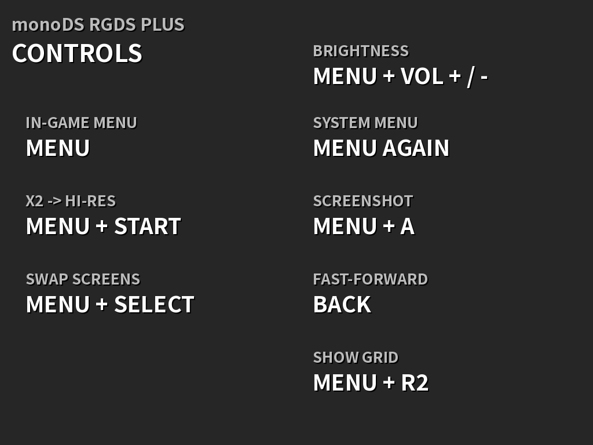
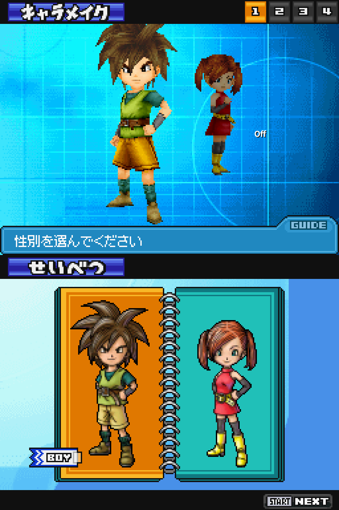
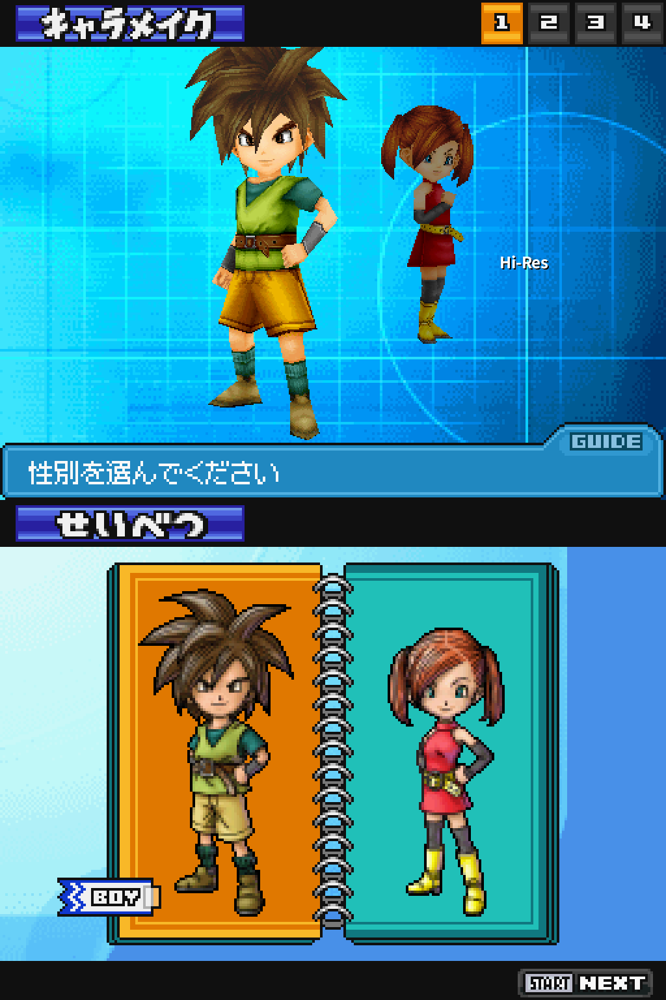
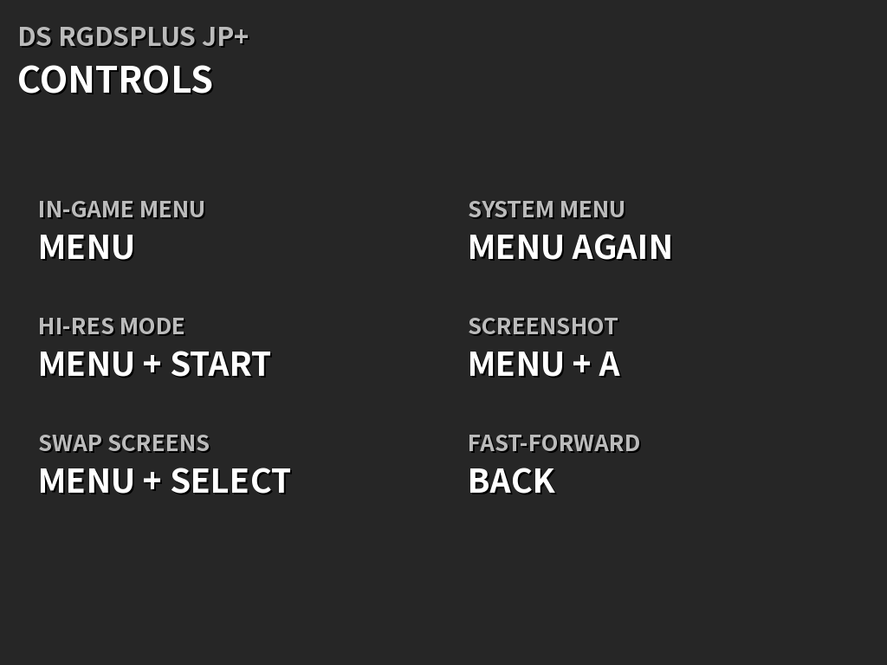

[English](README.md) | [日本語](README.ja.md)

# monoDS RG DS PLUS

A Japanese-language package based on [DEDICATED OS for the RG DS Plus](https://github.com/dedicated-os/dedicated-rgds-plus), retaining the original author's attribution and licensing.

This release can boot with either a TF1 card alone or both TF1 and TF2 cards. It also adds Japanese ROM support and Hi-Res 3D support.

|  |  |
| :---: | :---: |
| **Bootlogo** | **Original** |
|  |  |
| **x2** | **Hi-RES** |

### x2

x2 (Scale2x) is a display mode intended to improve image quality while preserving the original pixel look and smoothing edges. Its appearance depends on the game and personal preference, so compare it with Original and choose the one you prefer. Example for comparison: the 2D action game **Kirby: Squeak Squad**.

### Hi-RES

Hi-RES increases the resolution of 3D rendering. It can improve image quality in 3D-focused games, but in 2D-focused games such as **Kirby: Squeak Squad**, image quality may look worse. Switch modes per game and choose the display you prefer.

## Differences from DEDICATED OS

- Japanese ROM game titles are supported.
- Hi-Res 3D is supported.
- The system can boot with a TF1 card alone.

## Installation

### Using TF1 only

1. Download `monods-rgdsplus.img.zip` from [Releases](../../releases) and write the image to the TF1/INT card using an image-writing tool.
2. Insert the card into the TF1/INT slot and start the device.
3. Store your game data on the `MONODS` disk on the card.

### Using TF1 and TF2

1. As for a TF1-only setup, write `monods-rgdsplus.img.zip` to the TF1/INT card.
2. Format a MicroSD card for TF2/EXT as FAT32.
3. Download and extract `monods-rgdsplus.zip` from [Releases](../../releases), then copy all extracted contents to the root of the TF2/EXT card.
4. Put your games in `/games/` on TF2/EXT, insert both cards, and start the device.

## Controls

Press the device's **MENU** button to open the in-game menu. Press it again to open the system menu.

| Action | Shortcut |
| :--- | :--- |
| Toggle Hi-Res mode | `MENU + START` |
| Swap the top and bottom screens | `MENU + SELECT` |
| Toggle the screen grid | `MENU + R2` |
| Save a screenshot | `MENU + A` |
| Adjust brightness | `MENU + Volume + / Volume -` |
| Fast-forward | `BACK` |

`MENU + A` saves both screens together as one 1024×1536 BMP in `userdata/screenshots/`, named with the game title and an increasing serial (for example, `Game Title-0001.bmp`).

## Credits

DEDICATED OS for the RG DS Plus, which this project builds on, is created and maintained by [shauninman](https://github.com/dedicated-os/dedicated-rgds-plus). Please see the [original project](https://github.com/dedicated-os/dedicated-rgds-plus) for its documentation and licensing.
